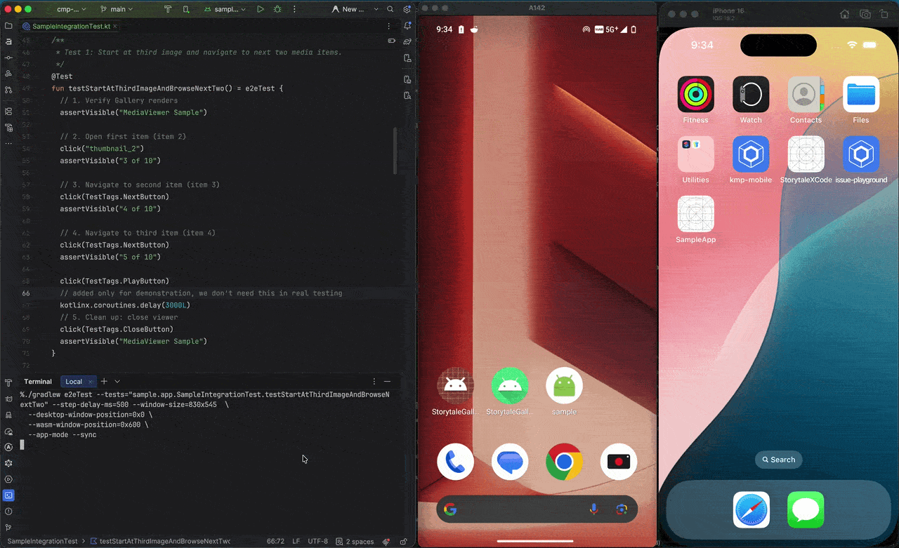

<h1 align="center">CMP Media Viewer - Compose Multiplatform Media Viewer Library</h1>

<p align="center">
  
  
</p>

<p align="center">
  <a href="https://github.com/aryapreetam/cmp-mediaviewer/actions/workflows/release.yml">
    
  </a>
  <a href="https://mvnrepository.com/artifact/io.github.aryapreetam/cmp-mediaviewer">
    
  </a>
  <a href="https://github.com/aryapreetam/cmp-mediaviewer/blob/main/LICENSE">
    
  </a>
</p>

<p align="center">
  
  
  
  
</p>

A full-screen media viewer library for Compose Multiplatform that enables displaying images and videos with pinch-to-zoom, panning, and swipe-to-dismiss support across Android, iOS, Desktop/JVM, and Web/WASM.



**Key Features:**

- 🖼️ **Image Viewer**: Pinch-to-zoom, double-tap zoom, and panning gestures.
- 🎥 **Video Viewer**: Video playback using platform-native players (Media3/ExoPlayer on Android, AVPlayer on iOS, VLC on Desktop, HTML5 on Web/Wasm).
- 🔁 **Horizontal Pager**: Swipe navigation between multiple media items in a slideshow/viewer session.
- 📍 **Position Indicator**: UI counter displaying the current page index and total items.
- ♿ **Keyboard Navigation**: Close on Escape key press, navigate pages using Left/Right arrow keys on Desktop and Web.

---

## ✅ Platform Capability Matrix

| Capability | Android | iOS | Desktop (JVM) | Web (WASM) |
|---|---:|---:|---:|---:|
| Image Viewer | ✅ | ✅ | ✅ | ✅ |
| Video Viewer | ✅ | ✅ | ✅* | ✅ |
| Pinch-to-zoom / Pan | ✅ | ✅ | ✅ | ✅ |
| Swipe Navigation | ✅ | ✅ | ✅ | ✅ |
| Keyboard Listeners | ❌ | ❌ | ✅ | ✅ |

*\*Desktop video playback relies on native VLC libraries (`libvlc`). Host machines must have VLC Media Player installed (`brew install --cask vlc` on macOS, `sudo apt install vlc libvlc-dev` on Linux). If VLC is not installed, the viewer displays an in-app notice with a retry option.*

Wasm Demo: 
[](https://aryapreetam.github.io/cmp-mediaviewer/demo/)

API Docs:
[](https://aryapreetam.github.io/cmp-mediaviewer/api/)

---

## 📦 Installation

Add the dependency to your Compose Multiplatform project:

**Option A — Version catalog (recommended)**

1) In `gradle/libs.versions.toml`:

```toml
[versions]
cmpMediaviewer = "0.0.3"

[libraries]
cmp-mediaviewer = { module = "io.github.aryapreetam:cmp-mediaviewer", version.ref = "cmpMediaviewer" }
```

2) In your module's `build.gradle.kts`:

```kotlin
kotlin {
  sourceSets {
    val commonMain by getting {
      dependencies {
        implementation(libs.cmp.mediaviewer)
      }
    }
  }
}
```

**Option B — Direct dependency**

```kotlin
kotlin {
  sourceSets {
    val commonMain by getting {
      dependencies {
        implementation("io.github.aryapreetam:cmp-mediaviewer:0.0.3")
      }
    }
  }
}
```

---

## 🚀 Quick Start

To open the full-screen media viewer component:

```kotlin
import io.github.aryapreetam.cmpmediaviewer.MediaViewer
import io.github.aryapreetam.cmpmediaviewer.model.MediaItem

@Composable
fun MyMediaScreen() {
  var showViewer by remember { mutableStateOf(false) }

  Column(modifier = Modifier.fillMaxSize()) {
    Button(onClick = { showViewer = true }) {
      Text("Open Media Viewer")
    }

    if (showViewer) {
      MediaViewer(
        items = listOf(
          MediaItem.image(id = "1", url = "https://example.com/photo.jpg", title = "Nature Photo"),
          MediaItem.video(id = "2", url = "https://example.com/clip.mp4", title = "Promo Video")
        ),
        initialIndex = 0,
        onDismiss = { showViewer = false },
        onPageChanged = { index -> println("Viewing index: $index") }
      )
    }
  }
}
```

---

## 📦 Download Sample App Executables

Download and try the sample app on your platform without building from source:

| Platform | Download Link |
|----------|--------------|
| 🍏 **macOS (Intel)** | [](https://github.com/aryapreetam/cmp-mediaviewer/releases/latest/download/sample-app-desktop-x64.dmg) |
| 🍎 **macOS (Apple Silicon)** | [](https://github.com/aryapreetam/cmp-mediaviewer/releases/latest/download/sample-app-desktop-arm64.dmg) |
| 🪟 **Windows** | [](https://github.com/aryapreetam/cmp-mediaviewer/releases/latest/download/sample-app-windows.msi) |
| 🐧 **Linux** | [](https://github.com/aryapreetam/cmp-mediaviewer/releases/latest/download/sample-app-linux.deb) |
| 🤖 **Android** | [](https://github.com/aryapreetam/cmp-mediaviewer/releases/latest/download/sample-app-android-unsigned.apk) |
| 🌐 **Web (Wasm)** | [](https://github.com/aryapreetam/cmp-mediaviewer/releases/latest/download/sample-app-wasm.zip) |
|  **iOS Simulator** | [](https://github.com/aryapreetam/cmp-mediaviewer/releases/latest/download/sample-app-ios-simulator.zip) |

### 🚀 How to Run the Sample App

For instructions on how to install and run the pre-built executables or build and run the sample application from source code, please refer to the **[How to Run the Sample App](docs/run-sample-app.md)** guide.

---

## License

MIT License © 2025 aryapreetam and contributors. See [LICENSE](./LICENSE) for details.

---

## 🤝 Contributing

See [CONTRIBUTING.md](CONTRIBUTING.md) for detailed contribution guidelines.
